# geoml-devcontainer-template

A ready-to-use template for **Python package development in a dev container**, aimed at
geospatial, SAR and machine-learning work.

One `git clone` and "Reopen in Container" gives you:

- **GPU-ready image**: NVIDIA CUDA, GDAL/PROJ, QGIS, GRASS, SAGA and Orfeo Toolbox
  (b-data JupyterLab CUDA + QGIS stack), with JupyterLab and a QGIS desktop in the browser (noVNC)
- **uv** for fast, locked Python dependencies (`pyproject.toml` + `uv.lock`)
- **Quality gates**: ruff (lint + format), mypy, pytest with coverage, pre-commit hooks
- **Docs** with mkdocs-material + mkdocstrings, and a **GitLab CI** pipeline that runs in the same image

**Documentation and setup guide: <https://geoml-template.imansour.net/>**

Author: Islam Mansour.

---

## Quick start (10 minutes)

### 0. Requirements

| Where the container runs | You need |
|---|---|
| Linux GPU server / workstation | Docker, NVIDIA driver, [NVIDIA Container Toolkit](https://docs.nvidia.com/datacenter/cloud-native/container-toolkit/) |
| Your laptop | VS Code with the *Dev Containers* extension (and *Remote - SSH* to use a server) |

No CUDA toolkit is needed on the host, only the driver. On a machine without an NVIDIA GPU
(e.g. an Apple Silicon Mac), remove `"--gpus", "all"` from `runArgs` in `.devcontainer/devcontainer.json`.

### 1. Connect to the GPU server

In VS Code, open the **Remote Explorer**, expand **SSH** and click the arrow next to your server
(here `pontus`) to connect. If the server is not listed, add it with
*Remote-SSH: Open SSH Configuration File…*.

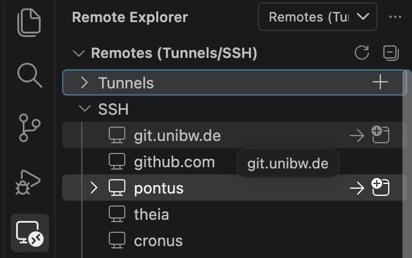

When connected, the status bar in the bottom-left shows `SSH: <server>`.

### 2. Make it your project

Open a terminal on the server (*Terminal → New Terminal*) and run:

```bash
git clone https://github.com/IslamAlam/geoml-devcontainer-template.git my_project
cd my_project
rm -rf .git
git init -b main
python3 scripts/rename_project.py my_project --author "Jane Doe" --email jane@example.org
rm scripts/rename_project.py
```

From the UniBw GitLab, clone with
`git clone ssh://git@git.unibw.de:2222/l91bisma/geoml-devcontainer-template.git my_project` instead.

`rename_project.py` renames the package `mypackage` everywhere (folder, imports, configs, docs)
and fills in the author. The base image tag stays `ltr` unless you add `--base-tag <version>`
(e.g. `--base-tag 3.44.15`) to pin a fixed QGIS version. Run `git init` **before** opening the container: the container setup
installs the git hooks into this repository.

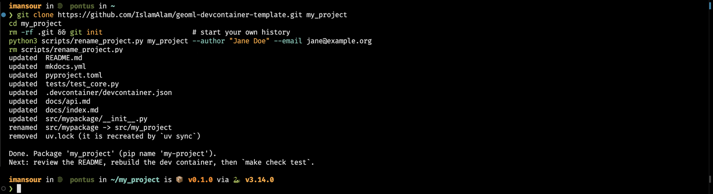

### 3. Open the project folder

*File → Open Folder…* and select the new `my_project` folder on the server.

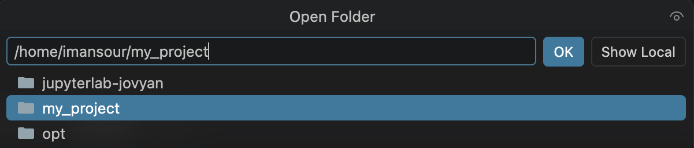

### 4. Reopen it in the container

VS Code detects `.devcontainer/` and offers **Reopen in Container**:

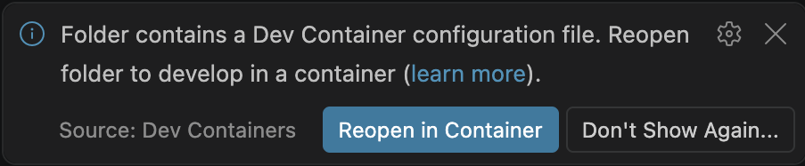

If you missed the notification, use the command palette (<kbd>F1</kbd> or
<kbd>Ctrl/Cmd</kbd>+<kbd>Shift</kbd>+<kbd>P</kbd>) → **Dev Containers: Reopen in Container**.
After changing the `Dockerfile` or `devcontainer.json`, run **Dev Containers: Rebuild Container**
(from inside the container) or **Rebuild and Reopen in Container** (from the server).

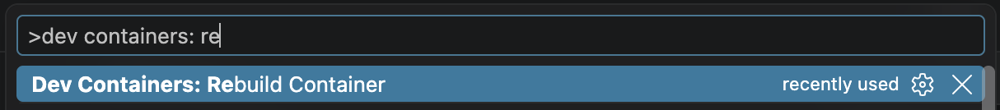

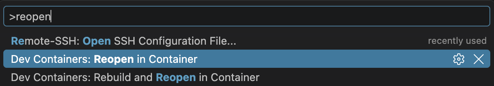

### 5. Wait for the first build

Click **show log** to follow progress. The first start pulls a large image and takes a few
minutes; later starts take seconds. Lines with `Exit code 1` in the log are normal checks, not errors.

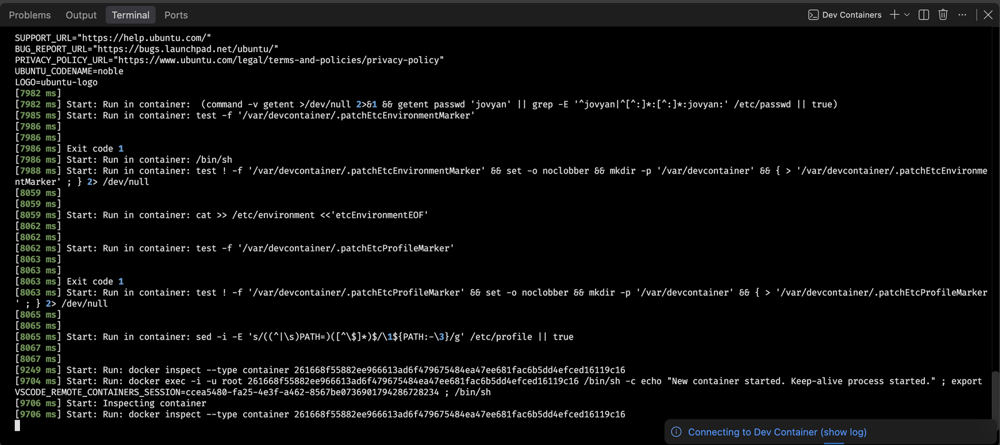

The container is ready when the status bar shows `Dev Container: my-project @ <server>` and the
setup terminal ends with `Dev container ready. Try: make help`.

### 6. Check that everything works

`make help` lists the available commands:

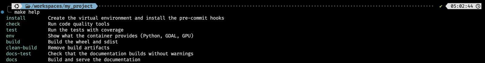

Install the ML extra (PyTorch) and check Python, GDAL and the GPU:

```bash
uv sync --extra ml
make env
```

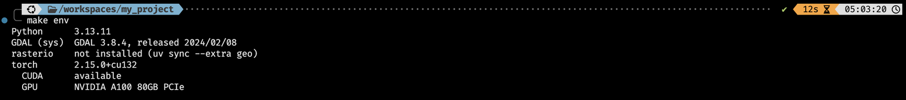

Run the tests and the code-quality checks:

```bash
make test
make check
```

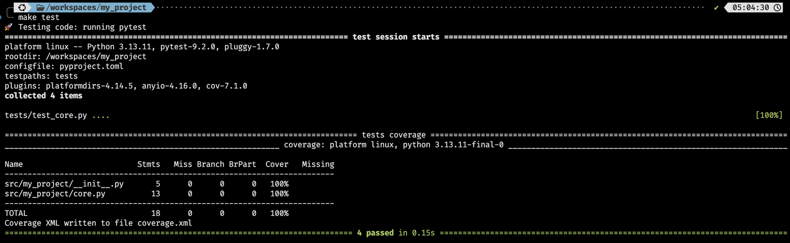

---

## Daily workflow

```bash
uv add rioxarray                 # add a runtime dependency (updates uv.lock)
uv add --dev pytest-xdist        # add a dev-only tool
uv sync --extra geo --extra ml   # install the optional geo / ML stacks
uv run python examples/check_environment.py
make help                        # list all make targets
```

Extras are not remembered: a plain `uv sync` removes `geo`/`ml` again. Repeat the `--extra` flags,
or use `uv sync --all-extras`.

Rule of thumb: **never `pip install` by hand**. Use `uv add`, so the change is in `pyproject.toml`
and `uv.lock` and everyone, including CI, gets the same environment.

## Project layout

```
.devcontainer/
  Dockerfile               # image: CUDA + GDAL + QGIS + uv
  devcontainer.json        # editor, GPUs, ports, post-create
  postCreateCommand.sh     # uv sync + pre-commit install
  devcontainer-local/      # your personal overrides (git-ignored)
src/mypackage/             # the package (installed in editable mode)
tests/                     # pytest
examples/                  # runnable scripts
docs/                      # mkdocs site
scripts/rename_project.py  # one-off: rename the template
pyproject.toml  uv.lock  Makefile  tox.ini
.pre-commit-config.yaml  .gitlab-ci.yml  mkdocs.yml
```

## JupyterLab and QGIS

The container keeps the image's own start command (`"overrideCommand": false`), so JupyterLab
runs on port 8888 next to your editor.

1. **Open JupyterLab.** In the **Ports** tab, VS Code has already forwarded port 8888.
   Click `localhost:8888` (or the globe icon) to open it in your browser.

    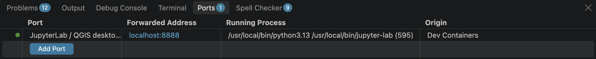

2. **Log in with the token.** JupyterLab asks for a token:

    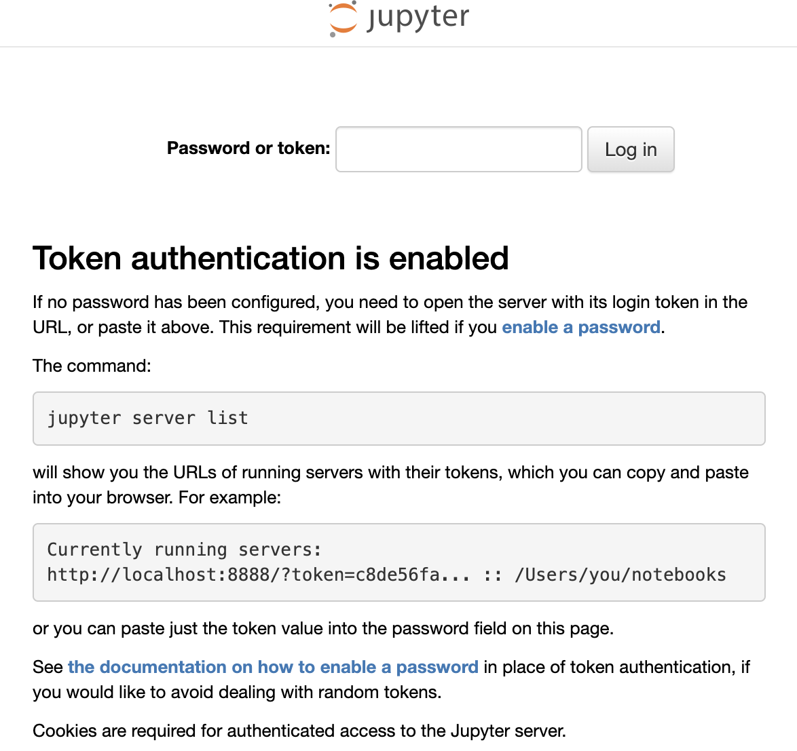

    In a terminal in the container, run `jupyter server list` and open the printed URL, or paste
    the part after `token=` into the page:

    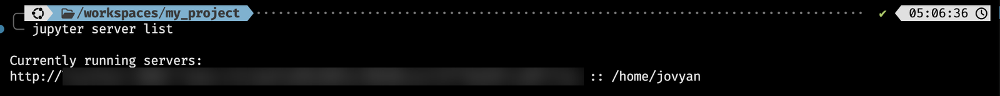

3. **Start the desktop.** In the JupyterLab launcher, click **QGIS Desktop**. It opens an Xfce
   desktop (noVNC) in a new browser tab.

    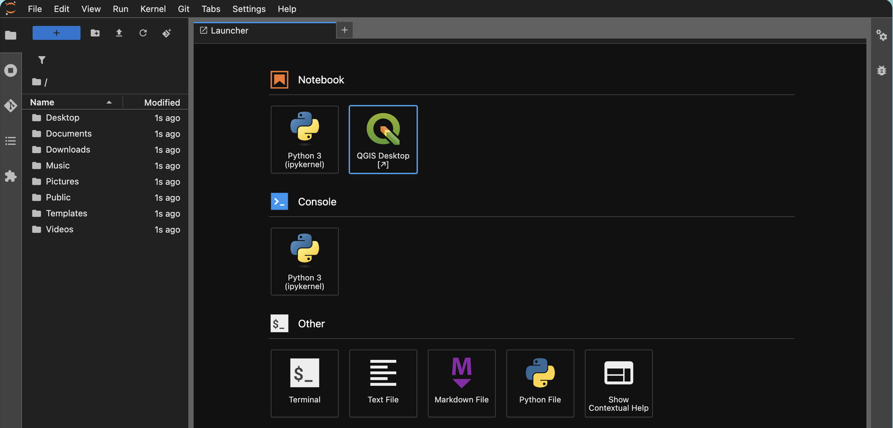

4. **Use QGIS, GRASS or SAGA.** They are under *Applications → Education*. Your project is at
   `/workspaces/my_project`, so QGIS sees exactly the files your code writes.

    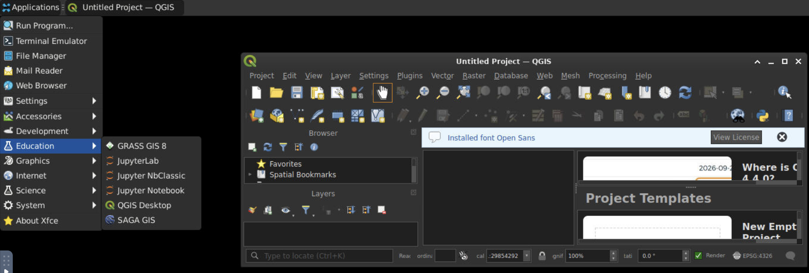

Without VS Code, forward the port yourself: `ssh -L 8888:localhost:8888 <server>`.

**PyQGIS:** QGIS's Python bindings live in the image's system Python, not in `.venv`. To use
`import qgis` from your project, create the venv with access to system packages:
`uv venv --system-site-packages && uv sync`.

## Personal settings and data

Do not edit the shared `devcontainer.json` for things that only apply to you (dataset mounts,
extra ports). Copy it to `.devcontainer/devcontainer-local/devcontainer.json` (git-ignored), change
`"dockerfile": "Dockerfile"` to `"dockerfile": "../Dockerfile"`, add your mounts, and pick that
configuration when VS Code asks which one to use for "Reopen in Container":

```jsonc
"mounts": [
  { "source": "/data/sentinel1", "target": "/data/sentinel1", "type": "bind", "readonly": true }
]
```

Never put data into the image or the repository.

## Reproducibility

- `uv.lock` pins every Python package. Commit it.
- `BASE_TAG` in `devcontainer.json` selects the base image. The default `ltr` follows the QGIS
  long-term release. For a fixed version, pass it to the rename script
  (`python3 scripts/rename_project.py my_project --base-tag 3.44.15`) or edit `BASE_TAG` by hand,
  then run *Dev Containers: Rebuild Container*. Pin the uv image tag in the
  Dockerfile too when you publish results.
- CI runs in a small uv image by default. To run it in the dev-container image instead, build and
  push `.devcontainer/Dockerfile` and set `CI_IMAGE` in GitLab (Settings → CI/CD → Variables).

## Documentation site

On every push to `main`, the `pages` CI job builds the mkdocs site and publishes it with GitLab
Pages (Deploy → Pages shows the URL). No extra setup is needed.

**Cloudflare (Workers & Pages) instead:** connect the repository and keep the deploy command
`npx wrangler deploy`. `wrangler.jsonc` builds the site with mkdocs into `site/` and serves it
as static assets. Rename `"name"` in `wrangler.jsonc` to your project.

## Image mirror

The base image comes from b-data's registry `glcr.b-data.ch`. If that registry is unreachable
(`docker pull` fails with *502 Bad Gateway*, *not found* or *No manifest found*), use the mirror on
Quay.io. In `.devcontainer/devcontainer.json`, set:

```jsonc
"BASE_IMAGE": "quay.io/is3mansour/jupyterlab-cuda-qgis-base",
"BASE_TAG": "ltr"
```

then run *Dev Containers: Rebuild Container*. The mirror is the b-data CUDA + QGIS image
(QGIS LTR) with this template's small additions already applied (build tools, htop, tmux, nvtop and
uv), which the Dockerfile simply installs again. Source code of the b-data image:
<https://github.com/b-data/jupyterlab-qgis-docker-stack> (GitHub mirror of
<https://gitlab.b-data.ch/jupyterlab/qgis/docker-stack>).

## Troubleshooting

| Symptom | Fix |
|---|---|
| `torch.cuda.is_available()` is `False` | Host lacks the NVIDIA Container Toolkit, or `--gpus all` is missing from `runArgs` |
| DataLoader crashes with shared-memory errors | Increase `--shm-size` in `runArgs` |
| Files created in the container are owned by root | Keep `"remoteUser": "jovyan"` and `"updateRemoteUserUID": true` |
| First build is slow | The CUDA + QGIS image is many GB; pull it once per server: `docker pull glcr.b-data.ch/jupyterlab/cuda/qgis/base:ltr` |
| `docker pull ... not found`, *No manifest found* or *502 Bad Gateway* for the base image | The b-data registry is down or the tag is gone. Switch to the [image mirror](#image-mirror), or list the tags with the command below and set another `BASE_TAG` |
| `postCreateCommand ... failed`: *git failed. Is it installed, and are you in a Git repository?* | The folder is not a git repository yet. Run `git init -b main`, then `make install` (or *Rebuild Container*) |
| `make env` says torch or rasterio is not installed | Install the extras: `uv sync --extra ml --extra geo` |
| JupyterLab asks for a password or token | Run `jupyter server list` in the container terminal and open the URL it prints |
| pre-commit changed files and the commit stopped | That is expected: `git add` the fixes and commit again |

### Listing the available base-image tags

Run on the server (needs only `curl` and `python3`):

```bash
REPO=jupyterlab/cuda/qgis/base
TOKEN=$(curl -s "https://gitlab.b-data.ch/jwt/auth?service=container_registry&scope=repository:$REPO:pull" | python3 -c "import sys, json; print(json.load(sys.stdin)['token'])")
curl -s -H "Authorization: Bearer $TOKEN" "https://glcr.b-data.ch/v2/$REPO/tags/list" | python3 -m json.tool
```

## Credits

Template by Islam Mansour. Project tooling inspired by
[fpgmaas/cookiecutter-uv](https://github.com/fpgmaas/cookiecutter-uv); base images by
[b-data](https://gitlab.b-data.ch/jupyterlab).
