# Getting started

From an empty folder to a GPU-ready package with JupyterLab and QGIS.
You need VS Code with the *Remote - SSH* and *Dev Containers* extensions, and a Linux server
with Docker, the NVIDIA driver and the NVIDIA Container Toolkit.

## 1. Connect to the GPU server

In VS Code, open the **Remote Explorer**, expand **SSH** and click the arrow next to your server
(here `pontus`) to connect. If the server is not listed, add it with
*Remote-SSH: Open SSH Configuration File…*.

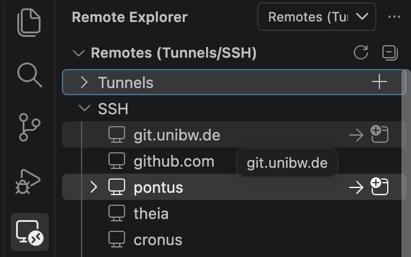

When connected, the status bar in the bottom-left shows `SSH: <server>`.

## 2. Make it your project

Open a terminal on the server (*Terminal → New Terminal*) and run:

```bash
git clone https://github.com/IslamAlam/geoml-devcontainer-template.git my_project
cd my_project
rm -rf .git
git init -b main
python3 scripts/rename_project.py my_project --author "Jane Doe" --email jane@example.org
rm scripts/rename_project.py
```

From the UniBw GitLab, clone with
`git clone ssh://git@git.unibw.de:2222/l91bisma/geoml-devcontainer-template.git my_project` instead.

`rename_project.py` renames the package `mypackage` everywhere (folder, imports, configs, docs)
and fills in the author. The base image tag stays `ltr` unless you add `--base-tag <version>`
(e.g. `--base-tag 3.44.15`) to pin a fixed QGIS version. Run `git init` **before** opening the container: the container setup
installs the git hooks into this repository.

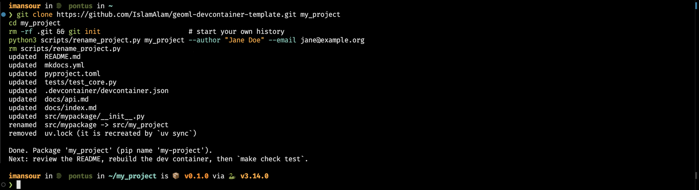

## 3. Open the project folder

*File → Open Folder…* and select the new `my_project` folder on the server.

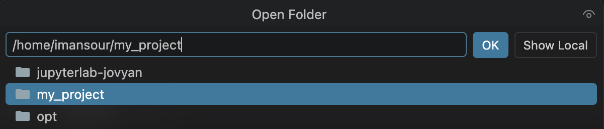

## 4. Reopen it in the container

VS Code detects `.devcontainer/` and offers **Reopen in Container**:

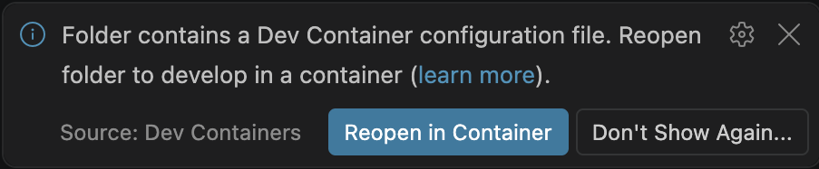

If you missed the notification, use the command palette (<kbd>F1</kbd> or
<kbd>Ctrl/Cmd</kbd>+<kbd>Shift</kbd>+<kbd>P</kbd>) → **Dev Containers: Reopen in Container**.
After changing the `Dockerfile` or `devcontainer.json`, run **Dev Containers: Rebuild Container**
(from inside the container) or **Rebuild and Reopen in Container** (from the server).

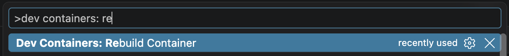

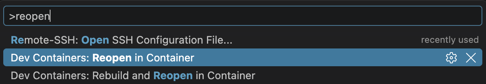

!!! tip "If the image download fails"
    If the log shows *502 Bad Gateway*, *not found* or *No manifest found* for
    `glcr.b-data.ch/...`, b-data's registry is down. Switch `BASE_IMAGE` in
    `.devcontainer/devcontainer.json` to the mirror `quay.io/is3mansour/jupyterlab-cuda-qgis-base`
    (source: <https://github.com/b-data/jupyterlab-qgis-docker-stack>) and rebuild.

## 5. Wait for the first build

Click **show log** to follow progress. The first start pulls a large image and takes a few
minutes; later starts take seconds. Lines with `Exit code 1` in the log are normal checks, not errors.

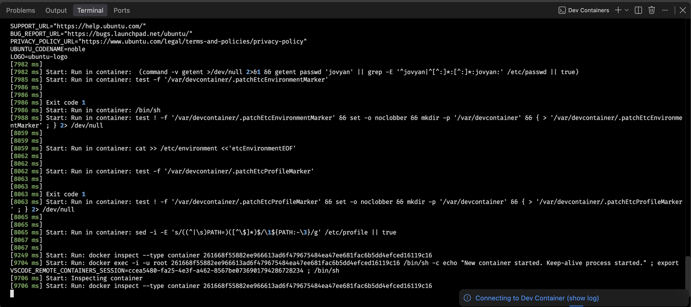

The container is ready when the status bar shows `Dev Container: my-project @ <server>` and the
setup terminal ends with `Dev container ready. Try: make help`.

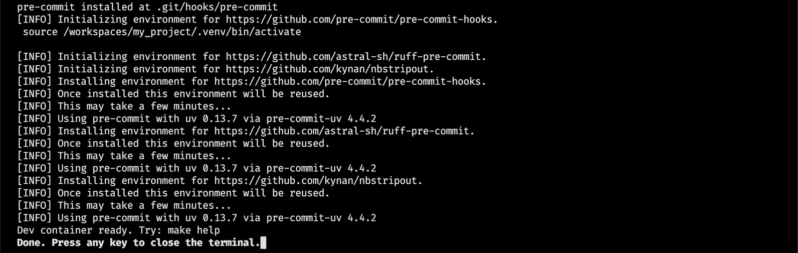

## 6. Check that everything works

`make help` lists the available commands:

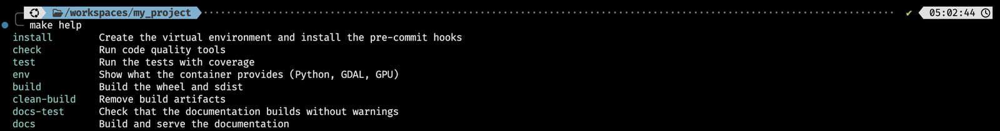

Install the ML extra (PyTorch) and check Python, GDAL and the GPU:

```bash
uv sync --extra ml
make env
```

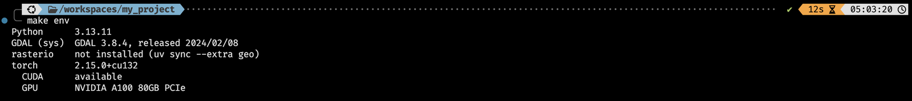

Run the tests and the code-quality checks:

```bash
make test
make check
```

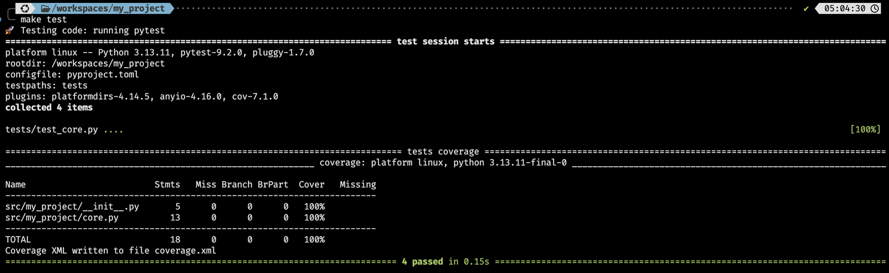

You can also run and debug single tests from the **Testing** panel (flask icon in the left bar):

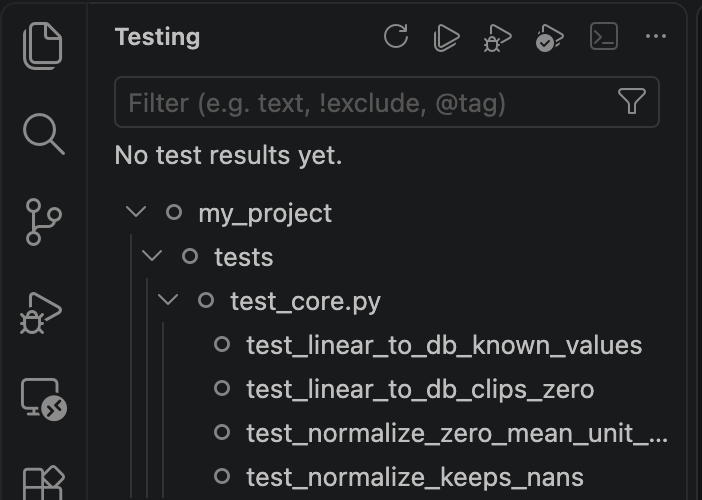

## 7. Make the first commit

If git does not know you yet inside the container, set your name and e-mail once:

```bash
git config --global user.name "Jane Doe"
git config --global user.email jane@example.org
```

Then commit. The pre-commit hooks check every commit; the first run takes a minute to set up:

```bash
git add -A
git commit -m "Initial commit"
```

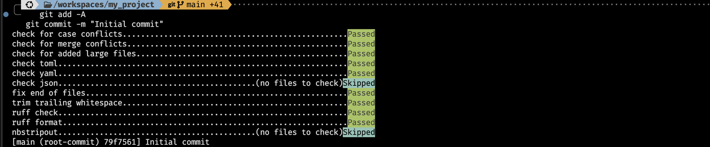

If a hook reports *Failed* because it fixed a file (formatting, trailing spaces), run
`git add -A` and commit again. To publish the project, create an empty repository on GitHub or
GitLab and follow its instructions to `git remote add origin …` and `git push -u origin main`.

## JupyterLab and QGIS

The container keeps the image's own start command (`"overrideCommand": false`), so JupyterLab
runs on port 8888 next to your editor.

1. **Open JupyterLab.** In the **Ports** tab, VS Code has already forwarded port 8888.
   Click `localhost:8888` (or the globe icon) to open it in your browser.

    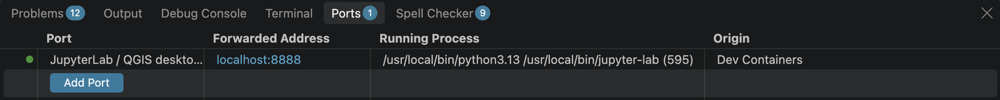

2. **Log in with the token.** JupyterLab asks for a token:

    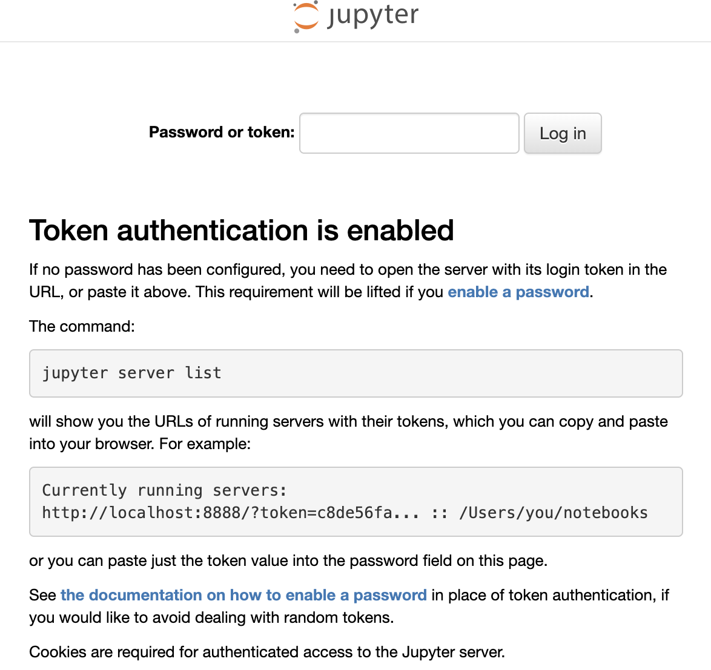

    In a terminal in the container, run `jupyter server list` and open the printed URL, or paste
    the part after `token=` into the page:

    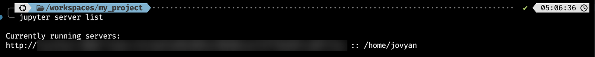

3. **Start the desktop.** In the JupyterLab launcher, click **QGIS Desktop**. It opens an Xfce
   desktop (noVNC) in a new browser tab.

    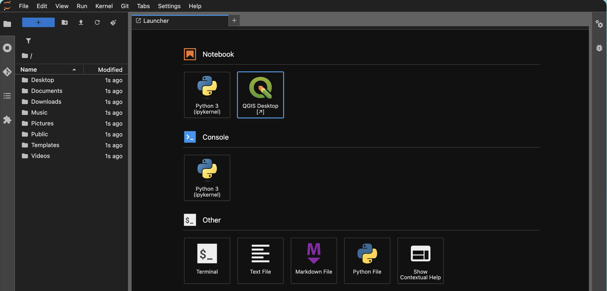

4. **Use QGIS, GRASS or SAGA.** They are under *Applications → Education*. Your project is at
   `/workspaces/my_project`, so QGIS sees exactly the files your code writes.

    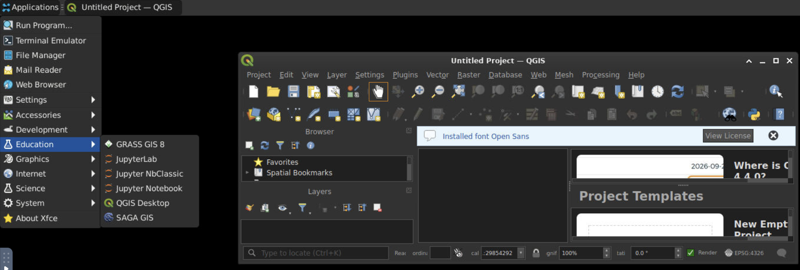

Without VS Code, forward the port yourself: `ssh -L 8888:localhost:8888 <server>`.

**PyQGIS:** QGIS's Python bindings live in the image's system Python, not in `.venv`. To use
`import qgis` from your project, create the venv with access to system packages:
`uv venv --system-site-packages && uv sync`.
